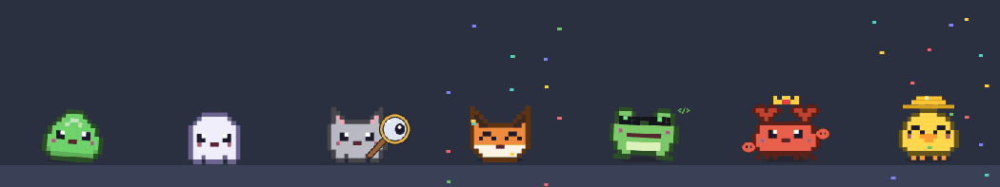
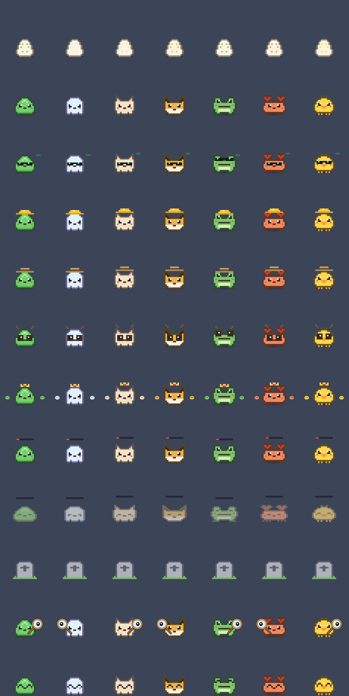

# Clawdling 🥚

**A tiny desktop pet for macOS that lives on your screen and eats while you work in [Claude Code](https://claude.com/claude-code).**
Stop working and it goes hungry. Forget it for two days and it dies.

<p align="center"></p>

- **Fed by your work.** Every prompt, file edit, command, web search, subagent and finished task drops food from the sky, and the pet catches it.
- **Lives on your screen.** It walks along the bottom of the screen, above the Dock, on every Space and over full-screen apps.
- **Throw it.** Grab it and fling it: the throw takes your cursor's speed, it falls with real gravity (9.81 m/s² scaled to your display's physical size), tumbles, bounces off the floor, walls and ceiling, and can fly over to the next monitor.
- **Plays when bored.** It pulls out a ball ⚽️, a ball of yarn 🧶 or chases a butterfly 🦋. You can kick the toy too.
- **A little assistant.** When Claude finishes a task, it throws a party with poppers and confetti 🎉. When Claude needs your approval, it grabs a magnifying glass and runs to your cursor to find you 🔍.
- **Grows the way you work.** A random creature hatches from the egg and evolves on day 7 according to how you fed it.
- **Quiet.** No speech bubbles, no notifications on screen. Only optional Telegram alerts when it is starving.

## Install

You need macOS 12+ and the Xcode Command Line Tools (`xcode-select --install`). No Xcode, no dependencies.

```bash
git clone https://github.com/aiaal03/clawdling.git
cd clawdling
./install.sh
```

The installer builds the app from source, copies it to `~/Applications`, adds Claude Code hooks to `~/.claude/settings.json` (a backup is saved next to it as `settings.json.bak-clawdling`), and starts it at login. You can delete the cloned folder afterwards. Run `./install.sh` again to update; your pet is kept.

Then work as usual: a couple of prompts and one finished task hatch the egg. If the egg doesn't react, restart Claude Code so it reloads the hooks.

**Uninstall:** `./uninstall.sh` removes the app, the hooks and the login item. Your pet's save stays in `~/.clawdling` unless you add `--purge`.

## How it works

| You do in Claude Code | Food | Fullness |
|---|---|---|
| Send a prompt | 🍙 | +3 |
| Claude finishes a turn | 🍪 | +5 |
| A file is edited | 🍎 | +1 |
| A shell command runs | ☕️ | +1 |
| Web search or browser | 🐟 | +2 |
| A subagent runs | 🎂 | +10 |
| Any other tool | 🍬 | +½ |

- Fullness tops out at 100 and drops by 4 per hour, so a full pet lasts about a day. Working once a day keeps it alive.
- At 0 it turns grey and lies down. **After 48 hours without food it dies.** Right-click the gravestone to bury it and take a new egg. The graveyard remembers everyone.
- After 20 idle minutes it falls asleep 💤. The next bite wakes it up.

### Species and evolutions

Each egg hatches into a random **slime, ghost, kitty, fox kit, froglet, crab or chick** with a random name and color. On day 7 it evolves based on its diet:

| Fed mostly by | Becomes |
|---|---|
| Shell commands | 🕶 **Hacker** |
| File edits | ⛑ **Builder** |
| Web searches | 🤠 **Explorer** |
| Work after midnight | 🦉 **Night Owl** |
| Subagents | 👑 **Hive Queen**, with two minions in orbit |

<p align="center"></p>

## Using it

- **Click** to pet it ❤️. **Double-click** for stats.
- **Drag** it anywhere, or **throw** it: let go while moving and it flies off at your cursor's speed.
- **Right-click** for the menu: stats, graveyard, size, walking on/off, give a toy, Telegram alerts, quit.
- Hover over it to see its name and fullness.

The interface is in English, or in Russian when macOS prefers Russian.

### Telegram alerts (optional)

Create `~/.clawdling/telegram.env` with a bot token from [@BotFather](https://t.me/BotFather) and your chat id:

```
BOT_TOKEN=123456:ABC...
CHAT_ID=123456789
```

The pet then messages you when it starts starving, when less than 6 hours are left, and when it dies.

## Under the hood

- `main.swift` is the whole app: one AppKit file, pixel sprites drawn with Core Graphics, no assets.
- `feed.py` is the hook. Claude Code runs it asynchronously on `UserPromptSubmit`, `PostToolUse`, `Stop`, `PermissionRequest`, `Notification` (permission prompts) and `PreToolUse` (`AskUserQuestion`). It only appends one line like `{"t": 1700000000.0, "k": "edit"}` to `~/.clawdling/events.jsonl`. Nothing about your prompts, files or commands is recorded, and nothing leaves your machine.
- The app tails that file, so food earned while it was closed is counted when it starts.
- State lives in `~/.clawdling/state.json`.

For development: `CLAWDLING_DIR=/tmp/pet ./build/Clawdling.app/Contents/MacOS/Clawdling` runs a separate pet with its own data, `CLAWDLING_SHEET=out.png` renders every species and state into one image, and `CLAWDLING_FRAMES=dir` renders the frames of the GIF above, and `CLAWDLING_THROW="vx,vy"` throws the pet 2 s after launch (points/s) to test the physics.

## License

MIT. Clawdling is a fan project and is not affiliated with or endorsed by Anthropic.

---

**По-русски:** Clawdling — тамагочи для macOS, который живёт внизу экрана и ест, пока ты работаешь в Claude Code. Каждый промпт, правка и законченная задача — еда. Не работаешь 48 часов — питомец умирает. Когда Claude закончил задачу, питомец празднует с конфетти; когда нужен approve, достаёт лупу и бежит к курсору. Установка: `git clone`, затем `./install.sh`. Интерфейс на русском, если система на русском.
